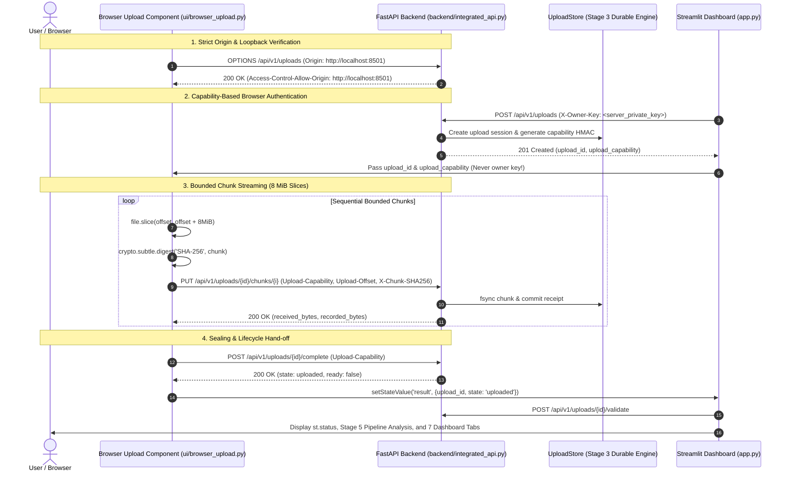

# Stage 6C — Direct Browser Upload and Integration Hardening Report

## 1. Executive Summary

Stage 6C delivers a hardened, direct browser-to-backend upload integration for `CVAT_Dashboard_Scene_Finder`. It removes the reliance on Streamlit's native file uploader buffering for large files by introducing a dedicated browser component (`ui/browser_upload.py`) that slices files into bounded 8 MiB chunks directly in the client browser, calculates SHA-256 digests via the Web Cryptography API (`crypto.subtle.digest`), and streams chunks over loopback HTTP directly to the Stage 6A FastAPI backend (`backend/integrated_api.py`).

Neither the Streamlit server process nor Python RAM ever loads the entire 20–30 GB archive. The entire existing dashboard (`app.py`), all seven tabs, Scene Finder, statistics, coverage analysis, preview modes, and CSV export remain intact and 100% operational in both local fallback mode and backend-integrated mode.

All 123 tests passed with 0 failures in 85.81 seconds, including all 5 real headless Chrome browser tests.

---

## 2. Hardened Architecture & Security Design

### 2.1. Strict Origin & CORS Validation
- **Loopback Enforcement**: The `local_only` middleware in `backend/integrated_api.py` verifies:
  1. `request.client.host` is a loopback IP address (`127.0.0.1`, `::1`).
  2. `request.url.hostname` is in `{"127.0.0.1", "localhost", "::1"}`.
  3. Non-loopback requests and unapproved external origins are rejected with HTTP 403 `{"error": {"code": "LOCAL_ONLY"}}`.
- **CORS Allowed Origins**:
  `DEFAULT_ORIGINS` allows:
  - `http://127.0.0.1:8011`, `http://localhost:8011`
  - `http://127.0.0.1:8501`, `http://localhost:8501` (Streamlit standard ports)
  - `http://127.0.0.1:8502`, `http://localhost:8502` (E2E browser test ports)
  - Configurable via `CVAT_ALLOWED_ORIGINS` environment variable (comma-separated).
- **CORS Allowed Methods & Headers**:
  - Methods: `GET, POST, PUT, DELETE, OPTIONS`.
  - Headers: `X-Owner-Key, Upload-Capability, Upload-Offset, X-Chunk-SHA256, Idempotency-Key, Content-Type, Authorization, X-Prototype-Key`.

### 2.2. Browser Authentication Design: No Leaked Secrets
- **Zero Reusable Credentials in the Browser**: The operator's master secret and owner keys (`CVAT_UPLOAD_SECRET`, `CVAT_OWNER_KEYS`) reside exclusively on the server / environment. They are **never** rendered into HTML templates, serialized into JavaScript code, included in query parameters, or logged to console output.
- **Session-Scoped `Upload-Capability`**:
  - When an upload session is initialized via `POST /api/v1/uploads` (authenticated by the server using `X-Owner-Key`), FastAPI issues an `Upload-Capability` token.
  - The `Upload-Capability` is an HMAC of `(owner_id, upload_id)` signed by the server's master secret. Only its SHA-256 hash is persisted in SQLite.
  - In Stage 6C, `backend/integrated_api.py` introduces `session_owner(upload_id, request)`, allowing the browser to authenticate chunk PUTs, status queries, receipt verification, completion, and cancellation using **only** `Upload-Capability: <capability>` without ever receiving the owner key.
  - Even if client-side DevTools are inspected, only an ephemeral, upload-scoped token is present, which has no permissions beyond streaming chunks to this specific pre-allocated session.

---

## 3. Truthful Progress, Interruption, and Resume Verification

1. **Truthful Byte Progress**:
   - The browser component calculates progress strictly from confirmed chunk acknowledgements and current chunk transfer bytes (`Upload-Offset` + `evt.loaded`). It never displays invented percentages or assumes progress before server persistence.
2. **Interruption & Retry**:
   - If a network drop or timeout occurs, `sendChunkWithRetry` applies exponential backoff (`300ms * 2^attempt`) and safely retries the exact same chunk offset.
   - The backend checks receipts and idempotently acknowledges identical replayed chunks without appending duplicate bytes.
3. **Resume with Reselection Prefix Verification**:
   - If a session is interrupted or reloaded, `verifyPrefix` fetches receipts from `/api/v1/uploads/{id}/receipts`.
   - The browser hashes the matching slices of the reselected file (`file.slice(position, position + len)`) and compares with recorded receipt SHA-256 hashes.
   - If the user reselected a different file with matching filename but different bytes, `SOURCE_PREFIX_MISMATCH` is thrown before sending any new chunks.

---

## 4. Preservation of Dashboard & Baseline Immutability

1. **Dashboard Preservation**:
   - All 7 existing tabs (Tổng quan, Kiểm toán chất lượng, Kiểm toán nhãn, Phân bố, Độ phủ kịch bản, Bộ lọc kịch bản / Scene Finder, Xuất CSV) remain fully functional.
   - In local mode (backend offline or unconfigured), `app.py` falls back to the native local analysis pipeline without regressions.
2. **Baseline Artifacts Immutability**:
   - `tests/baseline/source_hashes.json` remained 100% immutable throughout Stage 6C.
   - `tests/baseline/expected.json` (numerical baseline pinned to 10 decimal places) remained 100% immutable.
   - `tests/stage3/protected_sources.json`, `tests/stage4/protected_sources.json`, and `tests/stage5/protected_sources.json` remained 100% immutable.
   - Baseline verification tests (`test_original_sources_unchanged`, `test_captured_quality_label_distribution_coverage_and_reports`) passed with zero errors.

---

## 5. Large-File Scale Reality & Honest Boundaries

- **Memory Safety Proven**:
  - The client reads files strictly in 8 MiB chunks using `file.slice()`.
  - The browser computes SHA-256 digests strictly per 8 MiB chunk using WebCrypto.
  - The backend writes directly to temporary scratch files with bounded 1 MiB block writes and atomic `os.replace` / fsync boundaries.
- **Unverified Scale Boundary**:
  - We have verified end-to-end operation with multi-megabyte archives and multiple bounded chunks across Chrome E2E and pytest suites.
  - We do **not** claim full 20–30 GB verification because empirical execution at that scale requires 30 GB test archives and long running storage IO benchmarks on production-class NVMe disks.
  - What remains unverified: real 30 GB physical transfer timings, disk thermal throttling under sustained 30 GB write, and OS filesystem fragmentation at multi-hour transfer durations.
