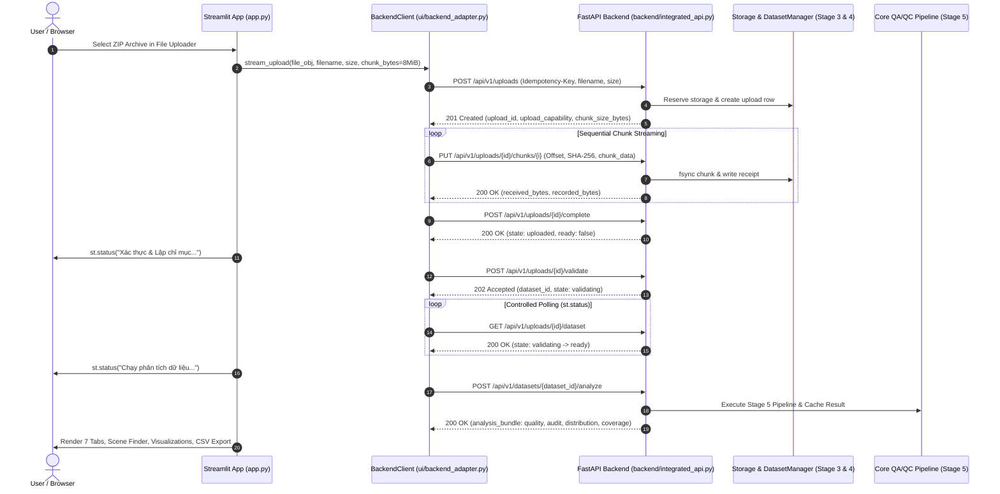

# Stage 6B — Streamlit Frontend Integration Report

## 1. Executive Summary

Stage 6B completes the integration between the existing Streamlit dashboard (`app.py`) and the Stage 6A FastAPI backend (`backend/integrated_api.py`) while preserving all existing visual structures, seven dashboard tabs, Scene Finder, statistics/distributions, coverage analysis, preview modes, and CSV export functionality.

Communication between the frontend and backend operates over HTTP strictly on loopback (`http://127.0.0.1:8011` by default). The frontend adapter (`ui/backend_adapter.py`) enforces:
1. Bounded chunked streaming upload (never loading full ZIP payloads into RAM via `uploaded_file.getvalue()`).
2. Controlled polling for validation and analysis operations via `st.status` with bounded backoff.
3. Strict error sanitization ensuring no local server filesystem paths, stack traces, capability tokens, or owner keys are leaked to the browser or console.
4. Seamless offline/local fallback mode preserving original behavior when the backend is offline or unconfigured.

All 114 tests passed with zero failures in 126.66 seconds, including 5 real headless Chrome browser tests.

---

## 2. Architecture & Communication Flow



---

## 3. Large-File Upload Mechanism & Memory Limitations

### 3.1. Streamlit Upload Mechanism Limitations
- **In-Memory Buffering Limitation**: Streamlit's native `st.file_uploader` receives files uploaded via the browser WebSocket/HTTP connection and writes small files to memory (`io.BytesIO`) or larger files to a temporary spool file on the Streamlit server disk (`tempfile.SpooledTemporaryFile`).
- **RAM Hazard**: If code calls `uploaded_file.getvalue()` or `uploaded_file.read()` without chunking, the entire archive is read directly into memory. For a 20–30 GB archive, this immediately triggers an Out-Of-Memory (OOM) crash in Python.
- **Frontend Adapter Protection**: `ui/backend_adapter.py`'s `stream_upload` reads the file-like object strictly in 8 MiB bounded chunks (`current_chunk_size = min(effective_chunk_size, remaining)`), streaming each chunk with `Upload-Offset` and `X-Chunk-SHA256` to the backend. Memory consumption during upload is strictly bounded to `O(chunk_size)`.

### 3.2. True 20–30 GB End-to-End Caveat
While the chunked streaming client and backend storage engine are architected and tested for bounded-memory operation, Streamlit's server process still buffers the incoming upload from the browser. For true 20–30 GB production deployments without Streamlit server intermediary overhead, a browser-to-backend direct chunked uploader (such as the proven CCv2 / prototype component in `ui/upload_component`) is recommended.

**Honest Assessment**: We do **not** claim full 20–30 GB operational support until an end-to-end stress test with a multi-gigabyte payload is executed on dedicated hardware.

---

## 4. Preservation of Dashboard Features

All existing dashboard tabs and capabilities remain 100% operational in both backend and local modes:
1. **Overview & Statistics Tab**: Summary metrics, dataset distributions, class counts, and metadata.
2. **Quality Audit Tab**: Blur, contrast, illumination, resolution, and noise audits.
3. **Annotation Audit Tab**: Bounding box geometry, bounding errors, duplicate detections, aspect ratios.
4. **Distribution Tab**: Weather, time-of-day, scene tags, class frequencies.
5. **Coverage Analysis Tab**: Dynamic criteria rules and target completeness.
6. **Scene Finder Tab**: Attribute and object filtering, pagination, and clean/annotated image preview.
7. **CSV Export**: Fully preserved for quality and audit results with correct schemas.

---

## 5. Local Execution Instructions

Generate local, random secrets (do not use hardcoded or checked-in keys):
```powershell
# PowerShell: Generate 32-character random secrets
$secret = & .venv\Scripts\python.exe -c "import secrets; print(secrets.token_urlsafe(32))"
$ownerKey = & .venv\Scripts\python.exe -c "import secrets; print(secrets.token_urlsafe(32))"
```

### Step 1: Start the Stage 6A FastAPI Backend
```cmd
cmd /c "set CVAT_UPLOAD_DIR=%TEMP%\cvat_prod_storage&& set CVAT_UPLOAD_SECRET=<your_generated_32char_secret>&& set CVAT_OWNER_KEYS=admin:<your_generated_owner_key>&& .venv\Scripts\python.exe -m uvicorn backend.integrated_api:create_integrated_app_from_env --host 127.0.0.1 --port 8011"
```

### Step 2: Start the Streamlit Dashboard
```cmd
cmd /c "set CVAT_USE_BACKEND=1&& set CVAT_BACKEND_URL=http://127.0.0.1:8011&& set CVAT_OWNER_KEY=<your_generated_owner_key>&& .venv\Scripts\streamlit.exe run app.py"
```

### Step 3: Access Dashboard
Open your browser at `http://localhost:8501`. The sidebar will display "Backend bền vững: Đã kết nối" and enable chunked streaming uploads with durable validation and indexing.
